# claude-mods

Mods for Claude Code. A mod is a plugin with a hooks module: it changes how
Claude Code behaves or what it shows. Each folder under `mods/` is one mod,
and every session loads all of them once the folder is declared.

## Install

From a clone of this repository:

```sh
./install.sh
```

This adds `mods/` to `env.CLAUDE_CODE_PLUGIN_DIRS` in `~/.claude/settings.json`
(the previous file is kept as `settings.json.bak`). Run it once per machine,
then start a new session. `./install.sh --uninstall` removes the declaration.

Requires `jq`.

## Mods

| Mod | What it does |
| --- | --- |
| [`effort-router`](#effort-router) | Runs the main loop at low effort on discussion and at high effort on implementation, which it hands to an implementer agent. |

## effort-router

For each message you send, effort-router decides whether it is discussion
(`chat`) or implementation (`impl`) and sets the effort of the main loop to
match: low for discussion, high for implementation. On implementation it also
asks the main model to plan, hand the code changes to an implementer agent and
review the result. The code is in [`mods/effort-router`](mods/effort-router).

<p align="center"></p>

### How it works

1. A slash command, a notification or an empty prompt is passed through as is,
   and the mode stays as it was.
2. If the mode is pinned with `/route chat` or `/route impl`, the pin decides,
   with no model call.
3. If the mode is `impl` and the message is a bare approval (`ok`, `vas-y`,
   `go ahead` and the like), it stays `impl`, with no model call.
4. Otherwise a classifier (`haiku` at low effort) reads the message, the end of
   the assistant's last answer and the current mode, and replies with a mode
   and its confidence, such as `chat 0.92`, usually within a few seconds.
   At a confidence of 0.6 or more the mode becomes its answer. Below
   that, after a 6 second timeout, or on a failure, the mode in force is kept.
   A new session starts in `impl`.
5. The mode sets every request of the main loop: `chat` runs at low effort,
   `impl` at high effort, each optionally on another model. Only the main loop
   of a session whose model id contains `routed_model` is routed. Subagents
   keep their own effort, and so does an effort you raised past high
   (`/effort xhigh`, ultrathink).
6. In `impl`, with `delegate` on, the message gets a note telling the main
   model to act as orchestrator: settle a plan, hand the code changes to the
   `effort-router:implementer` agent (opus at high effort by default), then
   review the diff and run the checks. A change of a few lines it has already
   located it may make itself.

### Commands

`/route` shows the mode, the classifier's timings and outcomes, how the last
message was routed, and the settings. `/route chat` or `/route impl` pins the
mode; `/route auto` goes back to choosing it per message.

### What it shows

A row in the band above the prompt shows the mode, the effort (and the model,
if one is set) it asks of the main loop, and how the last message was routed:

```
● chat · low · haiku: chat 0.92 in 1840 ms
● impl · high · haiku unsure: chat 0.55 < 0.6, kept impl
● impl · high · classifier timed out (6000 ms), kept impl
```

The first message was decided by the classifier. The second got an answer
below the minimum confidence and the third no answer in time: both kept the
mode in force, and that part of the row shows in the warning colour. A pinned
mode shows `(pinned)` after the effort.

### Options

Each option is a row in `/config`; a change reloads the mod. They are stored in
`~/.claude/settings.json` under `pluginConfigs["effort-router"].options`.

| Option | Default | Meaning |
| --- | --- | --- |
| `chat_effort` | `low` | Effort of the main loop on a discussion message |
| `impl_effort` | `high` | Effort of the main loop on an implementation message |
| `chat_model` | empty | Model of the main loop on a discussion message; empty keeps the session's model |
| `impl_model` | empty | Model of the main loop on an implementation message; empty keeps the session's model |
| `routed_model` | `fable` | Only a session whose model id contains this text is routed; empty routes every model |
| `classifier_model` | `haiku` | Model that decides chat or impl for each message |
| `classifier_timeout_ms` | `6000` | How long the classifier may take before the mode in force is kept |
| `classifier_min_confidence` | `0.6` | Confidence from 0 to 1 the classifier must give its answer for the mode to change; below it the mode in force is kept, and 0 accepts every answer |
| `delegate` | `true` | On an implementation message, tell the main model to hand the code changes to the implementer agent; off, only the effort and model change |
| `implementer_model` | `opus` | Model of the implementer agent |
| `implementer_effort` | `high` | Default effort of the implementer agent; the main model may pass another on a call |

Efforts are `low`, `medium`, `high`, `xhigh` or `max`; models are an alias
(`haiku`, `sonnet`, `opus`) or a full id. A main-loop model that changes
between messages loses the prompt cache.

## Adding a mod

Create `mods/<name>/` with `.claude-plugin/plugin.json`, `hooks/hooks.json` and
the hooks module. No new `install.sh` run is needed: a new session loads it,
and an interactive session reloads a mod when its files change.

```sh
claude plugin validate mods/<name>   # what the engine will accept or refuse
claude plugin test mods/<name>       # the mod's *.test.ts
```

Then give the mod its line in the index under [Mods](#mods) and a section of
its own with the same sub-headings as the others (How it works, Commands, What
it shows, Options), leaving out any that do not apply. A diagram goes in the
mod's `assets/` folder.

`.claude-plugin/types/` inside a mod is written by Claude Code and ignored by
git.
